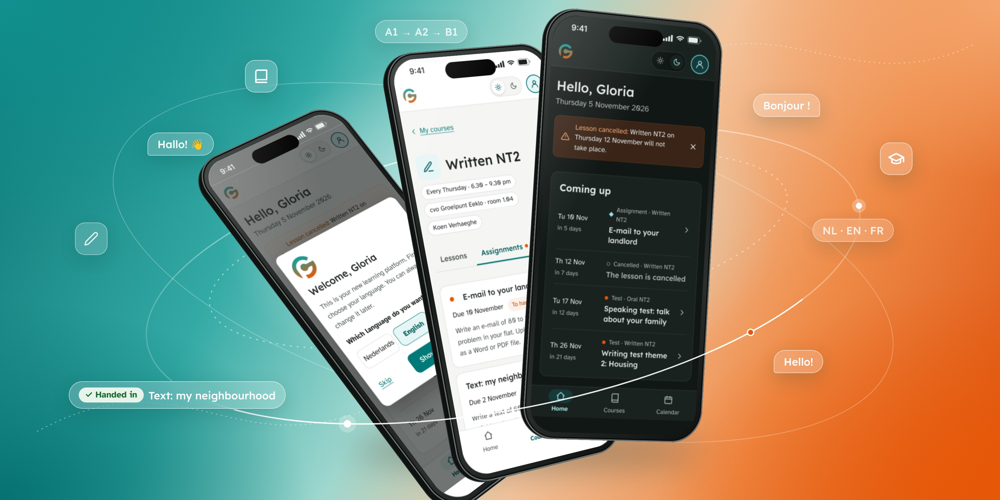

# GP Learning Platform

**A calm, multilingual learning platform for adults.**

A self-initiated UX/UI redesign of the student side of a Moodle platform used at an adult-education school in Flanders (cvo Groeipunt).

## Try it

- **[Open the prototype](https://gloriaoldini.github.io/gp-learning-platform/)**: start at the login page and click through everything.
- **[Screens and design notes](https://gloriaoldini.github.io/gp-learning-platform/screens.html)**: every screen on desktop, tablet and phone side by side, with the design decisions.

The first login starts a short welcome tour. To see it again, go to **Help → Take the tour again**.

## What's inside

| | |
|---|---|
| **Screens** | Login, help, home, my courses, course (lessons, assignments, tests, info, announcements), assignment, test result, calendar, announcements, help, app on your phone, profile, library, finished course |
| **Languages** | Dutch, English and French, switchable on every screen |
| **Devices** | Desktop, tablet and phone (responsive) |
| **Extras** | Dark mode, welcome tour, keyboard navigation, calendar export (.ics) |

## Design principles

1. **Tell me what to do next.** Home opens on *Coming up*: assignments, tests and cancelled lessons.
2. **One title, plain words.** Short course names (*Oral NT2*, *Written NT2*) and A2-level copy. No Moodle jargon.
3. **Three languages.** One tap away in the account menu.
4. **Calm by default.** Fewer menus, fewer colours. Status is always shown with colour *and* a word.

## Design system

- **Colours:** teal from the school logo for actions and links; orange only for things that need attention; green and red only for status.
- **Type:** [Lexend](https://fonts.google.com/specimen/Lexend) for headings, [Atkinson Hyperlegible](https://fonts.google.com/specimen/Atkinson+Hyperlegible) for body text. 17 px base, line height 1.6.
- **Components:** status tags, task rows, calendar symbols, buttons with the verb first, 44 px touch targets.

## Built with

Plain HTML, CSS and JavaScript in a single file, with no framework and no build step. Fonts come from Google Fonts.

## Notes

- This is a **portfolio prototype**, not the school's official platform. Buttons that would send data (messages, uploads, downloads) only show a confirmation.
- All names, grades and messages are **made up**. The school logo is used with permission.

---

Design and prototype by **Gloria Oldini** · [gloriao.com](https://gloriao.com)
